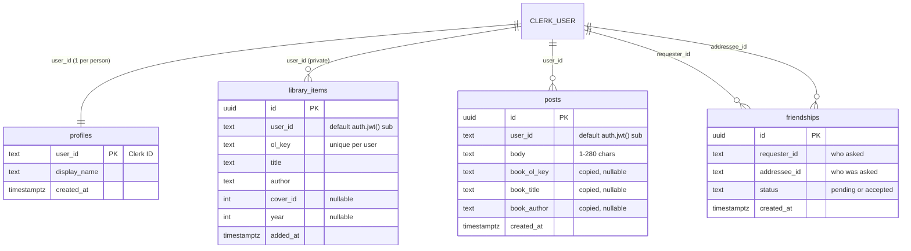

# Learning log

What I asked my agent at each step, what I learned, and what I caught or stopped it from doing.

## Step 1 · Choose the API: Open Library

**Calls made:** `GET https://openlibrary.org/search.json?q=…&fields=key,title,author_name,first_publish_year,cover_i&limit=20`

| Case | Result |
|---|---|
| A hit ("the hobbit") | `200`, `numFound: 461`, but it took **4.7 s** |
| Nothing found (gibberish, "submarine reactor manual") | `200` with `docs: []`. Not an error. |
| Empty search | `200` with empty results. The app must stop empty searches itself. |
| Missing fields | Some books have no `cover_i`. One had `first_publish_year: 1900` (bad data). |
| Cover | `covers.openlibrary.org/b/id/<cover_i>-M.jpg` returns a JPEG the browser can load directly |

**Ask:** "Explain this response: what each field means, and which ones my tool needs."

- `numFound`: the total number of matches. `0` means show the nothing-found state.
- `docs`: the list of books. The other wrapper fields (`num_found`, `numFoundExact`, `start`, `offset`, `q`, `documentation_url`) aren't needed.
- `key` (`/works/OL27482W`): the work's permanent ID across all editions. It prevents saving the same book twice and links back to Open Library.
- `title`: needed. `author_name`: a **list**, joined into one line when saved.
- `first_publish_year` and `cover_i`: optional, sometimes missing or wrong, so the UI can't depend on them.
- `fields=` keeps the response small. Without it, every book comes back with dozens of fields we'd throw away.

**Takeaways for the build:** the API can be slow (so a timeout, a loading state and caching), "nothing found" is a successful empty list rather than an error, and optional fields need fallbacks.

## Step 2 · Plan the data

Data model written to `AGENTS.md` and read by me before anything was built. **Rule: my library is private, and my posts are shared with my friends.**

**Ask:** "Draw a diagram of my tables: what each one holds, and how each row belongs to one person."

| Table | Owner column | Who can read |
|---|---|---|
| `profiles` | `user_id` (also the primary key: one row per person) | anyone signed in (names for the People tab) |
| `library_items` | `user_id`, filled from the token, never sent by the app | **only me** |
| `friendships` | `requester_id` and `addressee_id` | either of the two people |
| `posts` | `user_id`, filled from the token | me, plus people with an **accepted** friendship with me |

**Takeaways:**
1. One ID ties it all together. Clerk issues it, Supabase reads it from the token (`auth.jwt()->>'sub'`), and every row carries it.
2. `friendships` is the only table that unlocks anything. An *accepted* row lets you read another person's posts.
3. The library never unlocks for anyone else, so a post carries a **copy** of the book's title and author.

## Step 3 · Protect the keys

Deny rule in `.claude/settings.json`: `{"permissions": {"deny": ["Read(./.env)", "Read(./.env.*)"]}}`. I had already put the same rule in my user-wide `~/.claude/settings.json`. The project copy is what's committed, so it travels with the repo.

**Ask:** "Explain why this deny rule protects my keys. Then explain the difference between my publishable and secret keys, and where each one is allowed to go."

- **Why it protects them:** whatever the agent reads enters the conversation, which is sent to the model provider, may be logged, and can leak into commits or output. The rule makes Claude Code itself block the agent's file-reading tool on `.env` and `.env.*`, before the request reaches the model. It blocks **reading only**. Editing and creating files are separate permissions, so the project rule now denies `Edit` too, and I create `.env.local` myself.
- **Layers:** the deny rule (away from the agent), `.gitignore` `.env*` (away from GitHub), `process.env` (away from source code), and no `NEXT_PUBLIC_` prefix on secrets (away from the browser).
- **Publishable keys say who the app is.** They're visible in the browser to anyone, and on their own they can only do what Clerk sign-in and Supabase RLS allow.
- **Secret keys grant power.** Holding one makes you the server.

| Key | Browser | `.env.local` | Vercel | Code / Git / chat |
|---|---|---|---|---|
| Clerk publishable `pk_test_…` | yes | yes | yes | no |
| Supabase URL and publishable key | yes | yes | yes | no |
| Clerk secret `sk_test_…` | **never** | yes | yes | **never** |
| Supabase secret `sb_secret_…` | no | no | no | no. Not used in Kinnect (it bypasses RLS). |

**In class:** a key on its own unlocks nothing in Kinnect. The anonymous role has no RLS policies. Access comes from the signed, short-lived **Clerk session token**: Supabase checks its signature, reads my user ID, and RLS shows me only my rows.

**Caught:** the spec says the deny rule blocks the agent from writing `.env.local` too, and my agent first claimed a Read deny also blocks editing. It doesn't: Read and Edit are separate permissions. I added `Edit(./.env)` and `Edit(./.env.*)` denies to `.claude/settings.json` so the agent can neither read nor write env files.

## Step 4 · Sign-in with Clerk

Ran `npx -y clerk@latest init --app <my dashboard app> --no-skills`, after `clerk auth login` in my own terminal. I skipped Clerk's global agent skills, since that install happens outside this project. `init` installed `@clerk/nextjs`, created `src/proxy.ts` and the sign-in/sign-up pages, wrapped the layout in `<ClerkProvider>`, and wrote its env vars into `.env.local` itself (the agent never saw them).

**Caught in review of `init`'s output:**
- **Nothing was protected.** `init` wrote a bare `clerkMiddleware()`, and its own note says "routes are public by default". Fixed: `proxy.ts` now allows only `/`, `/sign-in` and `/sign-up`, and calls `auth.protect()` for everything else.
- **The build failed.** With `cacheComponents: true`, the catch-all sign-in route only knows its URL at request time, and both the nav's `usePathname()` and `<SignIn />` read it outside `<Suspense>`. Fixed by wrapping the nav, tab bar and Clerk pages in `<Suspense>`.
- **Layout formatting:** `init` re-wrapped the body without re-indenting it and dropped the final newline. Tidied.
- **The deny rule covers the shell too.** When the agent tried to check only the *size* of `.env.local` with `ls`, Claude Code blocked it.

**Check signed out (curl, no session):**

| Route | Result |
|---|---|
| `/`, `/sign-in`, `/sign-up` | `200` |
| `/feed`, `/friends`, `/friends/add`, `/me`, `/post/new`, `/api/books` | `307` → `/sign-in?redirect_url=…` |

### Passwordless sign-in with passkeys (my idea, added in step 4)

I wanted sign-in to be super simple and secure: never a password, just Face ID or a fingerprint.

- **Passkey-only isn't possible.** Clerk needs an email to create and recover the account. So it's: sign up with name, email and a 6-digit code, then add a passkey. After that, sign-ins are just the passkey, with the email code as the fallback.
- **The identifier is the email I type at sign-up**, proven by the code. It doesn't have to match my Apple or Google account. Apple and Google only store and sync the passkey (iCloud Keychain, Google Password Manager). Inside Kinnect and Supabase, the identity is the **Clerk user ID**, not the email.
- **Why passkeys are secure:** no password to leak or reuse, they only work on the exact site they were made for (phishing-proof), and Face ID only unlocks the key on the phone, so no biometric data ever reaches Kinnect or Clerk.
- **Development vs production:** classmates can sign up on the development instance (with a "Development mode" badge and a user cap). Passkeys are tied to a domain, so a `localhost` passkey won't work on the Vercel site.

**Clerk config change** (`clerk config pull` to read, then `clerk config patch --dry-run`, then apply):

| Setting | Before | After |
|---|---|---|
| Passwords | on, **required** (min 15 chars) | **off** |
| Passkeys for sign-in | off (button and autofill already allowed) | **on** |
| Email code sign-in | on | on (sign-up and fallback) |
| First and last name | optional | **required** (People needs names) |

**App change:** `PasskeyPrompt` shows a banner to signed-in users with no passkey on a browser that supports them. It calls Clerk's `user.createPasskey()`, ignores a cancelled Face ID sheet, explains other errors, and remembers "Not now" on the Clerk user.

**Caught:** `clerk config pull` showed first and last name were *enabled but not required*, even though the plan said to require them.

**Follow-up: passkeys "every time."**
- The **"Add a passkey" banner** now comes back on every visit until you add one. "Not now" hides it for that visit only (it used to hide it forever).
- **The sign-in page leads with a big "Sign in with passkey" button**, with Clerk's email-code form below it as the fallback. Browsers (Safari especially) won't open the Face ID sheet unless the person taps something, so one tap plus Face ID is the fastest sign-in a page can offer. Clerk's form also offers your passkey as an autofill suggestion.
- **Security detail:** after a passkey sign-in, the app returns you to the page you were bounced from (`redirect_url`), but only if that URL is on Kinnect itself. Otherwise a crafted link could send someone to another site right after they sign in (an "open redirect").

**Ask:** "Show me how the Clerk CLI works: what clerk init added to my project, file by file."

How the CLI works: `clerk auth login` (in my terminal) saves a token in the macOS credential store. `init` uses that token to call Clerk's API **as me**: it links the folder to my app (remembered through the git remote), detects Next.js and npm, installs the SDK, writes files, and fetches my dev keys into `.env.local`. That's why I never pasted the Clerk keys myself.

| File | What `init` did | What I changed after review |
|---|---|---|
| `package.json` / lockfile | added `@clerk/nextjs` (components, hooks, `auth()`, `clerkMiddleware`) | — |
| `src/proxy.ts` (new) | `clerkMiddleware()` runs before every matching request (skipping static files, always on `/api`), verifies the session cookie, and makes `auth()` work | it blocked no one, so I added `createRouteMatcher` and `auth.protect()` |
| `src/app/layout.tsx` | wrapped `<body>` contents in `<ClerkProvider>`, which loads Clerk in the browser and shares sign-in state | fixed indentation and the final newline; added Kinnect's `appearance` |
| `sign-in/[[...sign-in]]/page.tsx` (new) | Clerk's `<SignIn />`. The optional catch-all route covers Clerk's multi-screen flow (`/sign-in/factor-one`, …) | wrapped in `<Suspense>` (the build failed); passkey button on top |
| `sign-up/[[...sign-up]]/page.tsx` (new) | `<SignUp />`, same pattern | wrapped in `<Suspense>` |
| `.env.local` (gitignored) | Clerk publishable and secret keys, plus the sign-in/up route settings | — (the agent never read it) |

**In one sentence:** `clerk init` installed Clerk's SDK, added a proxy that identifies every request, a provider that shares sign-in state with the UI, catch-all sign-in and sign-up pages, and fetched my dev keys into `.env.local`. It left every route public and broke the build, and catching and fixing that was my job.

## Step 5 · Data in Supabase

**Setup (me, in the dashboards):** created the `kinnect` project (Free, East US, GitHub login), added the Supabase URL and publishable key to `.env.local` by hand, activated Clerk's Supabase integration (adds `"role": "authenticated"` to Clerk session tokens), and added Clerk under Supabase → Third-Party Auth (Supabase now trusts tokens signed by my Clerk instance, checked against Clerk's public keys). Project settings: Data API **on**, "Automatically expose new tables" **off**, automatic RLS **on**.

**MCP:** the agent's Supabase connector is limited to this one project (`project_ref=…`) and to the database, docs, debugging and development tools. I approved it with a browser login, so the agent never handled a Supabase token.

**What got built:**
- Two migrations, saved in `supabase/migrations/`: the four tables with RLS policies and grants, then fixes from Supabase's advisors.
- `src/lib/supabase.ts`: a server-side client per request whose `accessToken` is my Clerk session token.
- `src/lib/data.ts`: server-only reads. `ensureProfile()` creates my profile on first sign-in, and `ProfileSync` runs it from the layout.
- Installed only `@supabase/supabase-js`.

**Two locks on every table:**
1. **Grants:** may this role touch the table at all? Only `authenticated` gets grants, and only for what the app does. `anon` gets nothing.
2. **RLS policies:** which rows? Keyed on `sub` (my Clerk user ID) from the token.

**Checked (simulated users in a transaction that was rolled back):** Bob sees both profiles but only his own library. Bob can't see Alice's post until she **accepts** his request (pending isn't enough). Bob can't accept his own request. After accepting, both see both posts, but **neither sees the other's library**. Bob can't delete Alice's post. After Bob removes the friendship, her post disappears for him again. A non-Clerk token sees nothing. Then the attacks, each refused:

| Attempt | Result |
|---|---|
| Signed out, read any table, over the internet with only the public key | `permission denied` (no grant) |
| Accept a request **and** rewrite `requester_id` (forge a friendship) | `permission denied` (only `status` is updatable) |
| Bob inserts a post with `user_id` = Alice | `violates row-level security policy` |
| Bob creates an already-`accepted` friendship | `violates row-level security policy` |

**End to end:** I signed in and opened Feed, and my profile row appeared as "Ken Piech" under my Clerk user ID. That proves the chain: Clerk token → Supabase verifies the signature → issuer check → RLS lets me insert my own row, with `user_id` filled in from the token, not from the app.

**Caught:**
- **Supabase's setup page said to install `@supabase/ssr` too.** That package manages *Supabase Auth* sessions in cookies. Kinnect signs in with Clerk, so it would have been an unused second session system. Installed only `@supabase/supabase-js`.
- **Supabase trusts its own sign-in, not just Clerk.** Anyone with the publishable key could have created a Supabase Auth account, skipped Clerk, and been "authenticated", able to read every profile. Added a **restrictive** policy on every table that only accepts tokens issued by my Clerk instance (`iss`). Tested: such a token sees nothing.
- **Accepting a request could have forged a friendship.** A policy alone can't stop an UPDATE from changing other columns, so the addressee could have set `requester_id` to anyone and read their posts. Fixed with column-level grants: only `friendships.status` and `profiles.display_name` can be updated.
- **The security advisor flagged a function Supabase itself created.** "Enable automatic RLS" added `rls_auto_enable()` as SECURITY DEFINER in the public schema, callable by anyone at `/rest/v1/rpc/rls_auto_enable`. Revoked it in a second migration. The advisor is now clean, and auto-RLS still works (tested on a throwaway table).
- **Postgres's error hint suggests the dangerous fix.** For a signed-out read, it says `GRANT SELECT ON public.posts TO anon`. Following that would make every post public. The error is the lock working.
- **17 "performance" warnings were false positives.** The linter wants `(select auth.jwt())`, and we wrote `(select auth.jwt()->>'sub')`. `EXPLAIN` showed Postgres computes it once per query (an InitPlan) and uses the index, so I left them.
- **Clerk deprecation:** `createRouteMatcher` is going away, partly because `/sign-in(.*)` also matches look-alike paths like `/sign-inxyz`. Harmless today, since no such routes exist. Saved for the step 10 security review.

**Second lock, Supabase sign-ups off:** in Authentication → Sign In / Providers, I turned off "Allow new users to sign up" and left anonymous sign-ins off and "Confirm email" on. Tested from outside with only the public key: `POST /auth/v1/signup` → `422 signup_disabled`. Kinnect users are unaffected, since they sign up through Clerk and never become Supabase accounts.

**Ask:** "Explain each row-level security policy in plain words, then show me a query that one of them would block."

"Me" means the Clerk user ID in the request's token.

- **Every table, "kinnect clerk sessions only" (restrictive):** whatever else is allowed, the token must come from Kinnect's Clerk instance.
- **profiles:** anyone signed in can read every name (People needs it). You can only create your own profile, and only change your own name.
- **library_items:** you see, add and remove only your own books. Private even from friends.
- **friendships:** you see a friendship only if you're one of the two people in it. You can only send a request from yourself, as pending. Only the person who received a pending request can accept it, and accepting changes only the status. Either person can remove it (decline, cancel or unfriend).
- **posts:** you see your own posts plus posts by anyone you have an **accepted** friendship with, either direction (pending shows nothing). You can only write and delete your own.
- Posts and library items have no update policy and no update grant, so nobody can edit them.

**A blocked query** (real database, rolled back). Alice and Bob each saved a book and aren't friends. As Bob:

| Bob's query | Rows |
|---|---|
| `select * from library_items where user_id = 'user_A'` (Alice's, by name) | **0** |
| `select * from library_items` (no filter) | 1, his own |

The **read my library** policy blocked it. **Reads fail silently:** Bob gets zero rows, not an error, so he can't even tell whether Alice has a library. **Writes fail loudly:** inserting a post with Alice's ID gives `new row violates row-level security policy`. That's why the app never filters by user: `select * from library_items` already returns only mine, and a filter in the app would hide a broken policy from the Playwright test.
